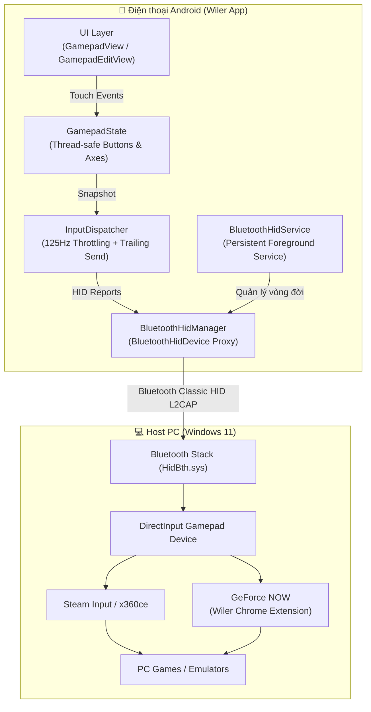

# 🎮 Wiler Gamepad

> **Biến điện thoại Android thành tay cầm chơi game không dây chuẩn Bluetooth HID kết nối trực tiếp với PC, không cần cài driver hay phần mềm trung gian.**

-3DDC84?logo=android&logoColor=white)


---

## 📖 Mục lục

- [Giới thiệu](#-giới-thiệu)
- [Tính năng nổi bật](#-tính-năng-nổi-bật)
- [Kiến trúc kỹ thuật](#-kiến-trúc-kỹ-thuật)
- [Yêu cầu hệ thống](#-yêu-cầu-hệ-thống)
- [Hướng dẫn cài đặt](#-hướng-dẫn-cài-đặt)
  - [1. Cài đặt ứng dụng Android (APK)](#1-cài-đặt-ứng-dụng-android-apk)
  - [2. Cài đặt Chrome Extension (Wiler Standard Gamepad Shim)](#2-cài-đặt-chrome-extension-wiler-standard-gamepad-shim)
- [Hướng dẫn kết nối & chơi game](#-hướng-dẫn-kết-nối--chơi-game)
  - [Ghép đôi với Windows PC](#ghép-đôi-với-windows-pc)
  - [Chơi game trên PC (Steam / Game thông thường)](#chơi-game-trên-pc-steam--game-thông-thường)
  - [Chơi game qua Cloud Gaming (GeForce NOW)](#chơi-game-qua-cloud-gaming-geforce-now)
- [Tự biên dịch từ mã nguồn](#-tự-biên-dịch-từ-mã-nguồn)
- [Cấu trúc thư mục](#-cấu-trúc-thư-mục)
- [Giấy phép](#-giấy-phép)

---

## 🌟 Giới thiệu

**Wiler Gamepad** là ứng dụng Android biến điện thoại của bạn thành một chiếc tay cầm chơi game không dây thực thụ. Nhờ tận dụng API `BluetoothHidDevice` gốc của hệ điều hành Android, thiết bị đóng vai trò là một thiết bị ngoại vi Bluetooth (Human Interface Device) chuẩn phần cứng.

Máy tính Windows, Android TV, macOS hay Linux sẽ nhận diện điện thoại như một tay cầm chơi game vật lý **mà hoàn toàn không cần cắm dây, không cần cài phần mềm server chạy ngầm (như Monect hay PC Remote)**.

---

## ✨ Tính năng nổi bật

### 1. ⚡ Độ trễ cực thấp (~125Hz, 8ms)
* **InputDispatcher chuyên biệt**: Xử lý trên `HandlerThread` độc lập với tốc độ polling 8ms (~125Hz), đảm bảo tốc độ phản hồi tức thì.
* **Trailing Send & Neutral Protection**: Cơ chế gửi vét đảm bảo không bao giờ bị nuốt sự kiện nhả nút hoặc kẹt phím khi buông tay hay rớt mạng.

### 2. 🎯 Cần gạt Joystick & Cảm ứng đa điểm
* **Radial Deadzone**: Lọc nhiễu tâm chuẩn xác, gia số độ nhạy tuyến tính mượt mà từ viền deadzone ra ngoài.
* **Dynamic Stick**: Cần gạt joystick tự động định vị lại tâm theo điểm chạm đầu tiên của ngón tay trong vùng cho phép.
* **Haptic Feedback**: Rung phản hồi nhẹ khi chạm nút ảo tạo cảm giác bấm chân thực.

### 3. 🛠️ Trình chỉnh sửa bố cục trực quan (Layout Editor)
* Tùy biến tự do vị trí và kích thước từng nút bấm hoặc cụm nút (D-Pad, ABXY, Cần gạt L/R, Triggers/Bumpers...).
* Tọa độ chuẩn hóa `[0.0, 1.0]` tương thích hoàn hảo mọi độ phân giải màn hình.
* Hỗ trợ **4 Preset cấu hình**: 1 Cấu hình Mặc định + 3 Cấu hình người dùng tùy chỉnh.
* Thanh công cụ di động kéo thả (Draggable Toolbar), chế độ xem trước toàn cảnh (Preview Mode).

### 4. 🔋 Tối ưu hóa pin thông minh (Auto-disconnect)
* Tùy chọn **Tự ngắt kết nối khi rời app**: Tự động ngắt kết nối sóng Bluetooth khi chuyển app hoặc tắt màn hình để tiết kiệm ~90% điện năng.
* Tự động kết nối lại (Auto-reconnect) mượt mà ngay khi bạn mở lại ứng dụng.

### 5. 🌐 Hỗ trợ Cloud Gaming (Chrome Extension)
* Kèm sẵn extension **Wiler Standard Gamepad Shim** dành cho Google Chrome / Microsoft Edge / Brave: Shim chuẩn hóa tín hiệu tay cầm Generic HID thành `Xbox 360 Controller (XInput STANDARD GAMEPAD)` tương thích 100% với nền tảng **GeForce NOW**.

---

## 🏗️ Kiến trúc kỹ thuật



---

## 📋 Yêu cầu hệ thống

| Thiết bị | Yêu cầu tối thiểu |
| :--- | :--- |
| **Điện thoại Android** | Android 9.0 (Pie / API 28) trở lên. ROM có hỗ trợ Bluetooth HID Device profile (Hầu hết các dòng máy Meizu, Xiaomi, Samsung, Pixel, OnePlus, v.v.). |
| **Máy tính / Host** | Windows 10/11, macOS, Linux hoặc Android TV có Bluetooth 4.0+. |
| **Trình duyệt (Tùy chọn)** | Chrome, Edge, Brave (Nếu chơi qua GeForce NOW trên Web). |

---

## 📥 Hướng dẫn cài đặt

### 1. Cài đặt ứng dụng Android (APK)

#### Cách 1: Tải và cài đặt file APK có sẵn
1. Truy cập thư mục chứa file APK đã đóng gói sẵn trong dự án:
   * **Bản Release (Tối ưu R8, dung lượng nhẹ ~4.4MB)**: `app/build/outputs/apk/release/app-release.apk`
   * **Bản Debug**: `app/build/outputs/apk/debug/app-debug.apk`
2. Chép file APK vào điện thoại và mở file để cài đặt (cho phép "Cài đặt từ nguồn không xác định" nếu được hỏi).

#### Cách 2: Cài đặt qua Android Debug Bridge (ADB)
Nếu điện thoại đang cắm cáp USB hoặc kết nối Wireless ADB:
```bash
adb install -r app/build/outputs/apk/release/app-release.apk
```

---

### 2. Cài đặt Chrome Extension (Wiler Standard Gamepad Shim)

Extension này giúp các nền tảng Cloud Gaming như **GeForce NOW** trên trình duyệt nhận diện tay cầm Wiler với đầy đủ nút bấm, D-pad và cần xoay chuẩn XInput.

1. Mở trình duyệt Chrome / Edge / Brave trên máy tính.
2. Truy cập vào trang quản lý tiện ích:
   * Chrome: `chrome://extensions/`
   * Edge: `edge://extensions/`
3. Bật công tắc **Chế độ dành cho nhà phát triển** (**Developer mode**) ở góc trên bên phải.
4. Bấm vào nút **Tải tiện ích đã giải nén** (**Load unpacked**).
5. Điều hướng và chọn thư mục `extension` trong thư mục dự án Wiler:
   ```
   D:\Android\Wiler\extension
   ```
6. Tiện ích **"Wiler Standard Gamepad Shim"** sẽ xuất hiện trên danh sách extension và tự động kích hoạt khi bạn truy cập trang `https://play.geforcenow.com/`.

---

## 🚀 Hướng dẫn kết nối & chơi game

### Ghép đôi với Windows PC
1. **Bật Bluetooth** trên cả điện thoại và máy tính.
2. Mở ứng dụng **Wiler Gamepad** trên điện thoại:
   * Bấm vào thẻ **"Bắt đầu ghép đôi với PC / Thiết bị mới"** (ứng dụng sẽ bắt đầu phát tín hiệu trong 120 giây).
3. Trên máy tính Windows:
   * Vào **Settings** > **Bluetooth & devices** > **Add device** > chọn **Bluetooth**.
   * Chọn thiết bị **"Wiler Gamepad"** (hoặc "Xbox Wireless Controller").
   * Xác nhận ghép đôi trên cả 2 thiết bị.
4. Sau khi ghép đôi thành công, bấm **"🎮 Vào Gamepad"** trên màn hình điện thoại để bắt đầu sử dụng.

> [!TIP]
> Bạn có thể kiểm tra tín hiệu và độ nhạy của các phím, joystick trên máy tính bằng cách truy cập trang [Gamepad Tester](https://gamepad-tester.com/).

### Chơi game trên PC (Steam / Game thông thường)
* **Đối với các game trên Steam**: Mở **Steam** > **Settings** > **Controller** > Bật mục **Enable Steam Input for generic controllers**. Steam sẽ tự động chuyển đổi tay cầm Wiler thành chuẩn Xbox XInput để chơi được 100% mọi tựa game.
* **Đối với game không thuộc Steam**: Có thể thêm game vào Steam qua mục *"Add a Non-Steam Game..."* hoặc sử dụng phần mềm giả lập [x360ce](https://www.x360ce.com/).

### Chơi game qua Cloud Gaming (GeForce NOW)
1. Đảm bảo bạn đã cài đặt extension **Wiler Standard Gamepad Shim** ở bước trên.
2. Kết nối tay cầm Wiler với máy tính.
3. Truy cập [play.geforcenow.com](https://play.geforcenow.com/), đăng nhập và khởi chạy game. Extension sẽ tự động shim tay cầm thành Standard Xbox 360 Gamepad!

---

## 💻 Tự biên dịch từ mã nguồn

Dự án sử dụng **Pure Java** (100% không dùng Kotlin) và Gradle Wrapper.

### Yêu cầu môi trường
* **JDK 17** hoặc JDK 21.
* **Android SDK** với API level 34 (`build-tools 34.0.0`).

### Các lệnh biên dịch

```bash
# Clone dự án
git clone https://github.com/your-repo/wiler.git
cd wiler

# Biên dịch bản Debug APK
./gradlew assembleDebug

# Biên dịch bản Release APK (đã tối ưu hóa R8 và ký debug keystore)
./gradlew assembleRelease
```

File APK đầu ra sẽ nằm tại:
* Release: `app/build/outputs/apk/release/app-release.apk`
* Debug: `app/build/outputs/apk/debug/app-debug.apk`

---

## 📁 Cấu trúc thư mục

```
Wiler/
├── app/
│   ├── src/main/
│   │   ├── java/com/wiler/gamepad/
│   │   │   ├── HomeActivity.java          # Màn hình trang chủ & quản lý ghép đôi
│   │   │   ├── GamepadActivity.java       # Giao diện tay cầm chính
│   │   │   ├── GamepadEditActivity.java   # Màn hình chỉnh sửa layout
│   │   │   ├── hid/                       # Tầng xử lý Bluetooth HID Core
│   │   │   │   ├── BluetoothHidManager.java
│   │   │   │   ├── InputDispatcher.java
│   │   │   │   ├── StandardHidDescriptor.java
│   │   │   │   └── XboxLikeHidDescriptor.java
│   │   │   ├── model/                     # Trạng thái tay cầm & Layout models
│   │   │   │   ├── GamepadState.java
│   │   │   │   ├── GamepadLayoutConfig.java
│   │   │   │   └── PreferencesManager.java
│   │   │   ├── service/                   # Foreground Service duy trì kết nối
│   │   │   │   └── BluetoothHidService.java
│   │   │   └── ui/                        # Custom Views & Bottom Sheets
│   │   │       ├── GamepadView.java
│   │   │       ├── GamepadEditView.java
│   │   │       ├── ConnectionBottomSheet.java
│   │   │       └── SettingsBottomSheet.java
│   │   ├── res/                           # Layouts, Drawables, Mipmaps, Values
│   │   └── AndroidManifest.xml
│   ├── build.gradle
│   └── proguard-rules.pro                 # Luật nén & bảo vệ mã nguồn R8
├── assets/
│   └── icons/                             # Các file vector SVG (app-icon, logo)
├── extension/                             # Chrome Extension cho GeForce NOW
│   ├── manifest.json
│   ├── inject.js
│   └── icons/
├── build.gradle
└── settings.gradle
```

---

## 📄 Giấy phép

Dự án được phát hành dưới giấy phép [MIT License](LICENSE).
Tự do sử dụng, chỉnh sửa và phân phối cho mục đích cá nhân và thương mại.
